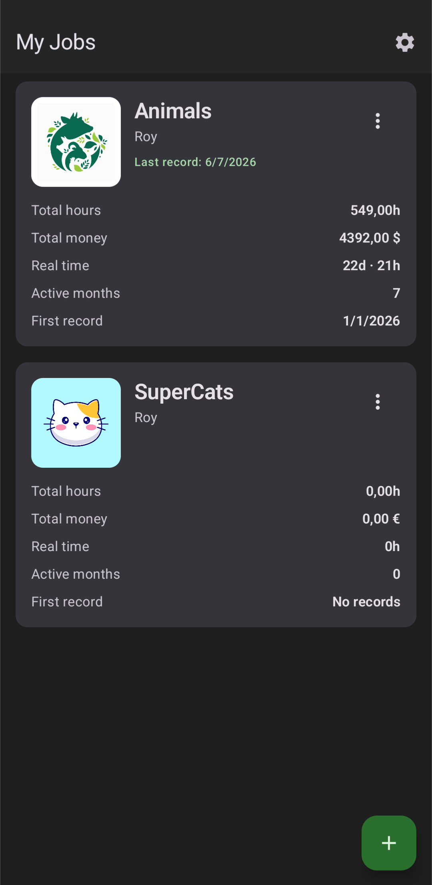
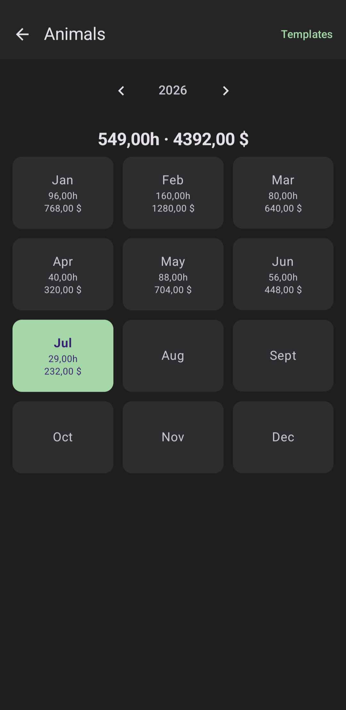
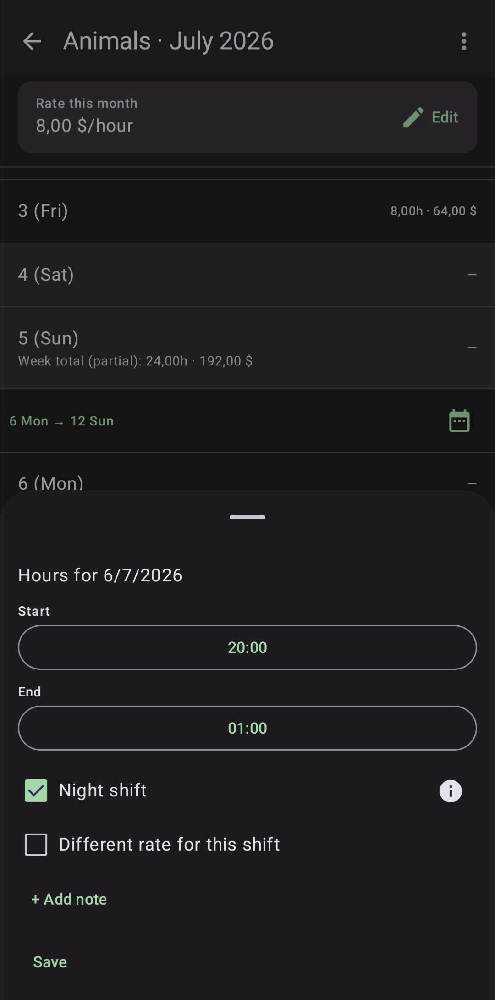
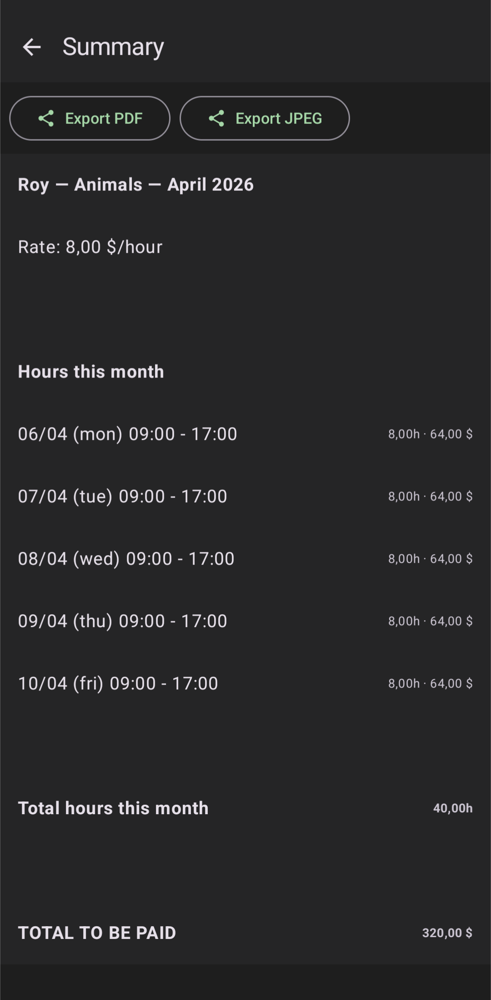
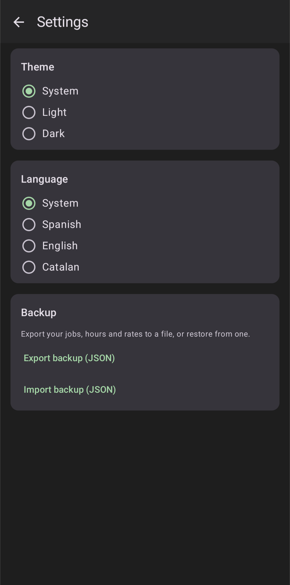
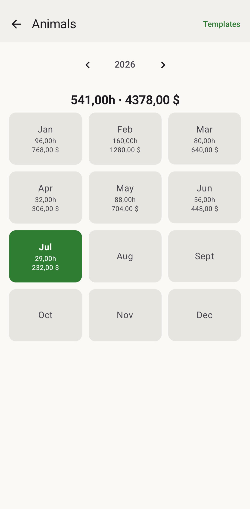
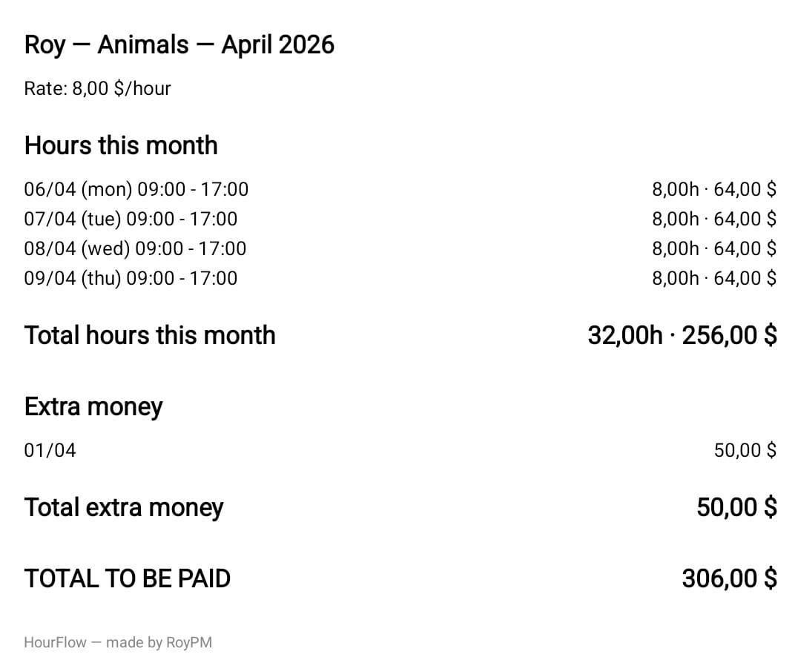

# HourFlow


HourFlow is a local-first Android app for tracking personal work hours, monthly rates, extra income, and shareable monthly summaries.

The project is built with Kotlin, Jetpack Compose, Material 3, Room, DataStore Preferences, Navigation Compose, and kotlinx.serialization. It is intentionally single-user and offline-first: all work data stays on the device unless the user exports it.

## Status

Personal project / portfolio-ready Android app. The app is functional, local-first, and distributed through GitHub Releases. Downloadable APKs are attached to each release.

## Screenshots

Screenshots use sample data.

<table>
  <tr>
    <th>Jobs</th>
    <th>Month</th>
    <th>Shift</th>
  </tr>
  <tr>
    <td></td>
    <td></td>
    <td></td>
  </tr>
</table>

<table>
  <tr>
    <th>Summary</th>
    <th>Settings</th>
    <th>Light Mode</th>
  </tr>
  <tr>
    <td></td>
    <td></td>
    <td></td>
  </tr>
</table>

<table>
  <tr>
    <th>Exported JPEG</th>
  </tr>
  <tr>
    <td></td>
  </tr>
</table>

## Features

- Track multiple independent jobs.
- Log one or more shifts per day from a monthly calendar view.
- Support night shifts that cross midnight.
- Store monthly hourly rates without recalculating previous months.
- Add positive or negative extra money entries per month.
- Reuse weekly and monthly work templates.
- View monthly and yearly summaries.
- Export monthly summaries as PDF or JPEG.
- Export and restore full JSON backups.
- Switch between system, light, and dark themes.
- Use Spanish, English, or Catalan UI strings.

## Engineering Highlights

- Local-first architecture with Room as the single source of truth.
- Repository + ViewModel + StateFlow separation.
- JSON backup/restore designed for round-trip data portability.
- Historical monthly rates so future rate changes do not recalculate past work.
- Night-shift handling for work sessions that cross midnight.
- CI workflow with unit tests, debug/release APK builds, downloadable artifacts, and automatic GitHub Releases.

## Privacy

HourFlow stores data locally on the device. It does not require accounts, servers, analytics, or network access.

## Tech Stack

- Kotlin
- Jetpack Compose
- Material 3
- Room / SQLite
- DataStore Preferences
- Navigation Compose
- kotlinx.serialization
- JUnit
- Gradle Wrapper

## Build

Requirements:

- JDK 17
- Android SDK with API 34

Build a debug APK:

```bash
./gradlew :app:assembleDebug
```

Build a release APK:

```bash
./gradlew :app:assembleRelease
```

On Windows:

```powershell
.\gradlew.bat :app:assembleDebug
.\gradlew.bat :app:assembleRelease
```

APK outputs:

- `app/build/outputs/apk/debug/app-debug.apk`
- `app/build/outputs/apk/release/app-release.apk`

Release builds use `keystore.properties` when present. If that file is not present, the project falls back to debug signing so anyone can clone and build the app locally without private signing keys.

## GitHub Actions

The Android workflow runs on pushes to `main`, pull requests to `main`, and version tags that start with `v`.

It checks that tests pass and both APK variants compile:

```bash
./gradlew test
./gradlew :app:assembleDebug
./gradlew :app:assembleRelease
```

Every workflow run uploads downloadable APK artifacts.

On pushes to `main`, the workflow reads `VERSION_NAME` from `gradle.properties` and creates a GitHub Release automatically when that version does not already exist. For example, `VERSION_NAME=1.0.0` publishes `v1.0.0`.

You can also publish a release manually by pushing a version tag:

```bash
git tag v1.0.0
git push origin v1.0.0
```

The generated release APK uses the same signing behavior as local builds: it uses `keystore.properties` when present and falls back to debug signing otherwise.

Version bumps are automated with Gradle tasks:

```bash
./gradlew bumpPatch
./gradlew bumpMinor
./gradlew bumpMajor
```

Each bump increments `VERSION_CODE` and updates `VERSION_NAME` in `gradle.properties`.

## Release Flow

For normal changes:

```bash
git add .
git commit -m "Describe the change"
git push
```

For a new release:

```bash
./gradlew bumpPatch
git add gradle.properties
git commit -m "Release 1.0.1"
git push
```

Use `bumpMinor` for feature releases and `bumpMajor` for large version changes. GitHub Actions creates the GitHub Release automatically when the new `VERSION_NAME` does not already exist.

## Tests

Run unit tests:

```bash
./gradlew test
```

On Windows:

```powershell
.\gradlew.bat test
```

## Architecture

HourFlow follows a simple Repository + ViewModel + StateFlow architecture:

```text
UI Layer (Compose Screens)
    <-> StateFlow
ViewModel Layer
    <-> suspend / Flow
Repository Layer
    <-> DAO
Room Database (SQLite)
```

The app keeps Room as the single source of truth. ViewModels expose screen state with `StateFlow`, repositories hide persistence details, and export/import logic lives in the data layer.

More detail: [docs/ARCHITECTURE.md](docs/ARCHITECTURE.md)

Development practices: [docs/DEVELOPMENT.md](docs/DEVELOPMENT.md)

## Roadmap

- Add portfolio screenshots and demo data captures.
- Add instrumentation tests for key Compose flows.
- Improve app icon and visual identity.
- Optional Play Store or internal testing distribution.

## License

MIT. See [LICENSE](LICENSE).
